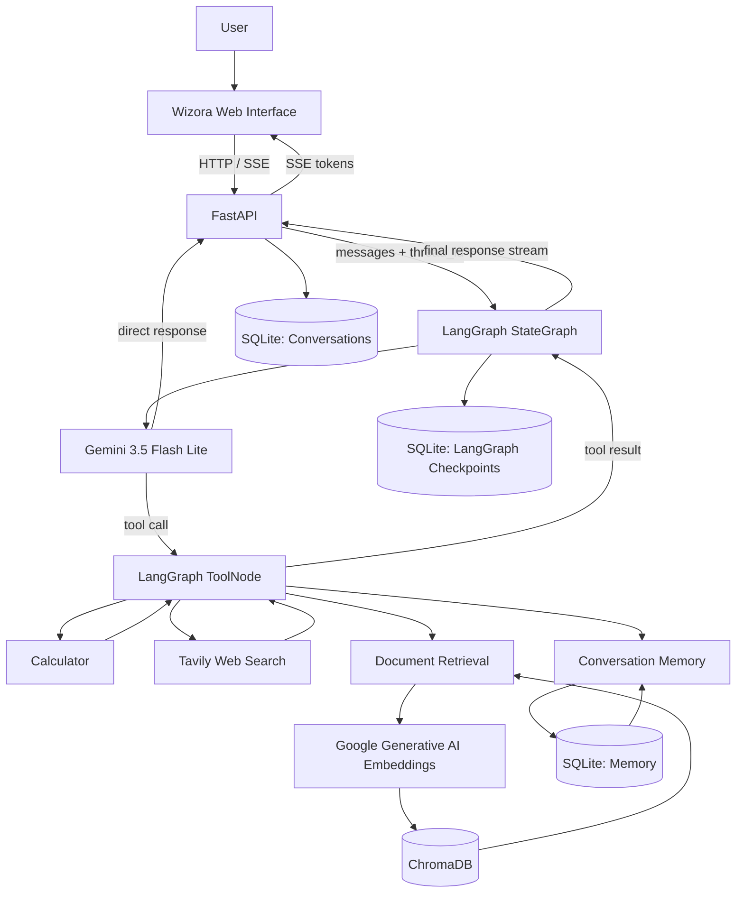

# Wizora — Agentic AI Assistant

Wizora is a web-based Agentic AI assistant built with Python, FastAPI, LangGraph, and Google Gemini. It combines conversational interaction with tool execution, web search, document retrieval, and conversation-scoped memory.

The project was developed as a practical exploration of how an LLM can move beyond a single prompt-and-response interaction and work with application state, external tools, and user-provided documents.

## 1. Project Overview

Wizora provides a chat interface where users can:

- Ask general questions and receive streamed responses.
- Ask the agent to perform calculations.
- Search the web through Tavily.
- Upload supported documents and ask questions about their contents.
- Save and recall information within a conversation.
- Reopen previous conversations from the history panel.
- Use browser-based voice dictation to enter a message.

The backend uses LangGraph to coordinate the model and tools. FastAPI exposes the application endpoints, while SQLite and ChromaDB persist conversation data, graph checkpoints, memory records, and document embeddings.

> **Project scope:** Wizora is a portfolio and learning project. The repository documents the implemented application and its tested workflows; it does not claim production-scale deployment or performance benchmarks.

## 2. Project Motivation

I wanted to build an assistant that demonstrates more than connecting a frontend to an LLM API. The main goal was to understand and implement the backend flow behind an agentic application:

1. Receive a user request through an API.
2. pass the conversation state to an LLM.
3. Let the model decide whether a tool is needed.
4. Execute the selected tool through LangGraph.
5. return the tool result to the model for a final response.
6. Persist conversation and workflow state so a conversation can be reopened.

Document retrieval and memory were added to explore how an assistant can work with information outside the model's immediate prompt.

## 3. Key Features

- **Agent workflow:** LangGraph state graph with conditional routing between the chatbot and tool execution nodes.
- **LLM integration:** Google Gemini, configured by default to `gemini-3.5-flash-lite`.
- **Tool calling:** Calculator, Tavily web search, document retrieval, and memory tools.
- **Document Q&A:** PDF, DOCX, TXT, Markdown, Python, and CSV ingestion.
- **Vector retrieval:** ChromaDB with Google Generative AI embeddings.
- **Conversation persistence:** Conversation list and message history stored in SQLite.
- **Graph checkpointing:** LangGraph checkpoints stored separately in SQLite.
- **Streaming responses:** Server-Sent Events (SSE) from FastAPI to the browser.
- **Markdown output:** Markdown rendering with a built-in fallback renderer and optional CDN-loaded parsing/sanitization libraries.
- **Voice dictation:** Browser Speech Recognition API integration for entering speech as text.

## 4. Technology Stack

| Area | Technology | Purpose |
|---|---|---|
| Language | Python | Backend application and agent logic |
| API | FastAPI | HTTP endpoints, file uploads, and streaming |
| ASGI server | Uvicorn | Runs the FastAPI application |
| Agent orchestration | LangGraph | Stateful, conditional agent workflow |
| LLM integration | LangChain | Model and tool integration |
| Language model | Google Gemini 3.5 Flash Lite | Generates responses and tool calls |
| Embeddings | Google Generative AI Embeddings | Converts document chunks into vectors |
| Vector store | ChromaDB | Persists and retrieves document chunks |
| Relational storage | SQLite + SQLAlchemy | Conversations, messages, and memory |
| Graph persistence | LangGraph SQLite Checkpointer | Saves graph state by thread |
| Web search | Tavily | Retrieves current web results |
| Document parsing | pypdf, docx2txt | Extracts text from PDF and DOCX |
| Frontend | HTML, CSS, JavaScript | Chat interface and browser interactions |

## 5. System Architecture



### Persistence layers

Wizora uses separate persistence mechanisms for different responsibilities:

- `data/wizora.db`: SQLAlchemy tables for conversations, chat messages, and long-term memory records.
- `data/langgraph_checkpoints.sqlite`: LangGraph checkpoint data used to restore graph state for a `thread_id`.
- `chroma_db/`: ChromaDB persistent vector collection for uploaded document chunks.
- `uploads/`: Original uploaded files.

The local runtime folders and database files are excluded from Git by `.gitignore`.

## 6. How Wizora Works

### Normal chat

1. The browser sends the message, selected model, and conversation `thread_id` to `POST /chat/stream`.
2. FastAPI creates or updates the conversation and stores the user's message.
3. The request is passed to the compiled LangGraph agent.
4. The chatbot node invokes Gemini with the system instructions and current graph messages.
5. FastAPI streams text chunks to the browser using SSE.
6. The completed assistant response is stored in the conversation database.

### Tool execution

When Gemini requests a tool, LangGraph routes the request from the chatbot node to `ToolNode`. The tool result is added to the graph state, and control returns to the chatbot node so Gemini can formulate the response.

### Conversation state

The frontend creates a UUID for a new conversation and stores the active `thread_id` in browser local storage. The same ID is used by the conversation database and LangGraph checkpointer when a conversation is reopened.

## 7. Agent Tools

Wizora exposes five tools to the agent:

| Tool | Responsibility |
|---|---|
| `calculator` | Evaluates supported mathematical expressions |
| `tavily_search` | Searches the web using Tavily |
| `search_uploaded_documents` | Retrieves relevant chunks from the current conversation's uploaded documents |
| `remember_this` | Saves a memory record for the current conversation |
| `recall_memory` | Retrieves recent saved memory records for the current conversation |

### Calculator implementation

The calculator uses Python's `ast` module and an explicit allowlist of operators, functions, and mathematical constants. It does not evaluate arbitrary Python expressions with `eval()`.

The implementation also applies expression-length, AST-node-count, exponent, and numeric-result checks.

### Tool execution debugging

`debug_tools.py` streams LangGraph updates and prints:

- The graph node that ran.
- The tool requested by the model.
- The arguments sent to the tool.
- The tool execution result.

This made it possible to verify that a tool was actually called and executed, rather than relying only on the frontend's progress indicator.

## 8. RAG and Document Processing

The document pipeline is implemented in `rag.py`.

### Supported formats

- PDF (`.pdf`)
- Word (`.docx`)
- Plain text (`.txt`)
- Markdown (`.md`)
- Python (`.py`)
- CSV (`.csv`)

### Ingestion flow

1. FastAPI receives the uploaded file through `POST /upload`.
2. The filename is normalized and the file is saved with a generated UUID.
3. `read_file_text()` extracts text using `pypdf`, `docx2txt`, or Python file reading.
4. `RecursiveCharacterTextSplitter` divides the text into chunks.
5. Each chunk is stored as a LangChain `Document`.
6. ChromaDB stores the document chunks and their embeddings.

Current splitter settings:

| Setting | Value |
|---|---:|
| Chunk size | 900 characters |
| Chunk overlap | 150 characters |
| Default retrieval count (`k`) | 4 |
| Embedding model | `gemini-embedding-001` |
| Chroma collection | `wizora_docs` |

Each chunk includes `thread_id` and source filename metadata. Retrieval filters by the active `thread_id`, so a conversation searches its own uploaded documents rather than documents belonging to another conversation.

## 9. Memory Management

Memory records are stored in the `long_term_memory` SQLite table.

- `remember_this` saves a text memory with its `thread_id`.
- `recall_memory` retrieves saved records for that same `thread_id`.
- The current implementation returns up to the 20 most recent records for the conversation.

**Important implementation detail:** memory is conversation-scoped, not a global user profile shared by every new chat. Also, the current `search_memory()` implementation accepts a query parameter but does not yet use it to rank or filter memories by semantic relevance. These are deliberate boundaries of the current implementation and useful areas for future development.

## 10. Conversation Management

The `database.py` module defines three SQLAlchemy models:

- `Conversation`: conversation ID, title, creation time, and last update time.
- `ChatMessage`: message role, content, conversation ID, and creation time.
- `LongTermMemory`: saved memory text, conversation ID, and creation time.

The frontend uses the conversation ID to load previous messages from `/history/{thread_id}`. The New Chat action generates a new UUID, separating the new conversation from existing conversation history.

LangGraph checkpoints are stored separately from these application-level records.

## 11. Project Structure

```text
Wizora/
├── agent.py                  # LangGraph workflow and Gemini configuration
├── app.py                    # FastAPI application and SSE endpoints
├── database.py               # SQLite models and persistence functions
├── rag.py                    # Document parsing, chunking, and retrieval
├── tools.py                  # Calculator, web search, RAG, and memory tools
├── debug_tools.py             # LangGraph tool execution inspection
├── test_connections.py       # External service connectivity checks
├── requirements.txt          # Python dependencies
├── .env.example               # Environment variable template
├── .gitignore                 # Excludes local secrets and runtime data
├── LICENSE                    # Apache License 2.0
└── templates/
    └── index.html             # Wizora frontend
```

## 12. API Endpoints

| Method | Endpoint | Purpose |
|---|---|---|
| `GET` | `/` | Serves the Wizora interface |
| `GET` | `/conversations` | Returns saved conversations |
| `GET` | `/history/{thread_id}` | Returns messages for a conversation |
| `POST` | `/upload` | Uploads and indexes a supported document |
| `POST` | `/chat/stream` | Runs the agent and streams the response using SSE |

### Streaming response

`POST /chat/stream` accepts a JSON body similar to:

```json
{
  "message": "Calculate 1287 * 349",
  "thread_id": "your-conversation-uuid",
  "model": "gemini-3.5-flash-lite"
}
```

The response is sent as Server-Sent Events. Text chunks are emitted as token events, followed by a completion event. Tool messages and raw tool outputs are filtered from the user-facing text stream.

## 13. Installation and Setup

### Prerequisites

- Python 3.10 or later.
- A Google AI API key.
- A Tavily API key for web search.
- Git.

### Windows PowerShell

```powershell
git clone https://github.com/Mennaamohame/Wizora.git
cd Wizora

python -m venv .venv
.\.venv\Scripts\Activate.ps1

python -m pip install --upgrade pip
pip install -r requirements.txt

Copy-Item .env.example .env
```

Open `.env` and add your API keys.

Start the application:

```powershell
python app.py
```

Open the local application at:

```text
http://127.0.0.1:8080
```

### Other platforms

Create and activate a virtual environment using the commands appropriate for your operating system, install `requirements.txt`, configure `.env`, and run `python app.py`.

## 14. Environment Variables

Create a local `.env` file using `.env.example` as a template.

| Variable | Required | Description |
|---|---|---|
| `GOOGLE_API_KEY` | Yes | Google AI API key for Gemini and embeddings |
| `TAVILY_API_KEY` | For web search | Tavily API key |
| `GEMINI_MODEL` | No | Model name; defaults to `gemini-3.5-flash-lite` |
| `LANGSMITH_TRACING` | No | Enables or disables LangSmith tracing |
| `LANGSMITH_ENDPOINT` | No | LangSmith API endpoint |
| `LANGSMITH_API_KEY` | No | LangSmith API key |
| `LANGSMITH_PROJECT` | No | LangSmith project name |

Never commit `.env` or real API keys to GitHub.

## 15. Testing and Validation

The project was tested through direct tool-execution debugging and manual interaction with the web interface.

### Tool execution checks

| Test | Observed result |
|---|---|
| Calculator: `1287 * 349` | Returned `449163` |
| Division by zero | Returned a division-by-zero error instead of crashing the calculation flow |
| Tavily search | Debug output showed the search tool request, execution, and returned results, including official Python.org pages |
| Tool routing | `debug_tools.py` showed the chatbot node requesting tools and the tools node executing them |

### Memory and document checks

| Test | Observed result |
|---|---|
| Save preferred demo language | Saved English as a memory record |
| Recall preferred demo language | Returned English in the same conversation |
| RAG project-owner lookup | Returned Menna Elrais |
| RAG budget lookup | Returned 48,750 EGP |
| RAG tracking ID lookup | Returned `WZ-TRACK-731` |
| RAG Test Record B lookup | Returned Omar Nabil |
| RAG retrieval count lookup | Returned 4 chunks |
| Missing phone number and database IP | Responded that the information was not available in the uploaded document |

### Frontend checks

The interface was manually exercised for:

- Markdown headings, bold and italic text, lists, inline code, fenced code blocks, and links.
- Conversation history and New Chat.
- Document upload.
- Voice input.
- Streaming assistant responses.

### Available test scripts

Run the tool execution checks:

```powershell
python debug_tools.py
```

Run external service connectivity checks:

```powershell
python test_connections.py
```

`debug_tools.py` verifies actual LangGraph tool requests and execution. `test_connections.py` checks connectivity to configured external services. These scripts are smoke tests; they are not a replacement for a complete automated unit and integration test suite.

## 16. Engineering Challenges and Solutions

### 1. FastAPI template path resolution

**Problem:** The application returned `TemplateNotFound` when the HTML file was not located under the directory expected by Jinja2.

**Investigation:** The project folder had initially been created with a spelling mismatch (`templats` instead of `templates`).

**Solution:** The template path was based on `BASE_DIR` rather than relying only on the process's current working directory. The application also checks the earlier misspelled directory as a compatibility fallback.

**Result:** The application can locate `index.html` using the project-relative template directory.

### 2. Isolating tool context between conversations

**Problem:** The original tool implementation used a mutable global variable to hold the active conversation ID. Concurrent requests could overwrite shared state.

**Solution:** The current implementation uses Python's `ContextVar` to hold the active `thread_id` in the request execution context.

**Result:** Tool functions can obtain the conversation context without relying on a single shared global variable.

### 3. Verifying real LangGraph tool execution

**Problem:** A frontend progress indicator alone does not prove that the LLM requested a tool or that LangGraph executed it.

**Solution:** A dedicated `debug_tools.py` script inspects LangGraph updates and prints tool requests, arguments, execution nodes, and tool results.

**Result:** Calculator and Tavily tool calls could be inspected at the graph level.

### 4. Safer calculator evaluation

**Problem:** Evaluating model-provided mathematical expressions with Python `eval()` would allow a broader execution surface than a calculator requires.

**Solution:** The calculator was implemented with `ast.parse()` and explicit allowlists for supported operators, functions, and constants. Expression complexity and numeric bounds are also checked.

**Result:** The calculator supports mathematical expressions without evaluating arbitrary Python code.

### 5. Separating conversation history from graph checkpoints

**Problem:** Application-visible chat history and the internal state required to resume a LangGraph workflow serve different purposes.

**Solution:** Conversation records and messages are stored through SQLAlchemy in `wizora.db`, while LangGraph state is persisted through `SqliteSaver` in `langgraph_checkpoints.sqlite`.

**Result:** The application can retrieve chat history while LangGraph maintains its own checkpoint state.

### 6. Document retrieval scoped to a conversation

**Problem:** Uploaded content should not be mixed between separate conversations.

**Solution:** The ingestion pipeline stores `thread_id` in each ChromaDB document's metadata, and retrieval filters by the active conversation ID.

**Result:** RAG queries are restricted to documents associated with the active conversation.

### 7. Markdown rendering and external library availability

**Problem:** Markdown rendering depends on browser-side JavaScript and external parsing/sanitization libraries may not always load from a CDN.

**Solution:** The frontend attempts to load Marked and DOMPurify from multiple CDN locations and includes a built-in fallback Markdown renderer. The primary rendering path sanitizes generated HTML, and links are checked before being opened.

**Result:** The interface has a fallback rendering path for common Markdown elements when the external libraries are unavailable.

## 17. Future Improvements

Potential next steps include:

- Add automated unit and integration tests with `pytest`.
- Add semantic or keyword-based memory retrieval using the supplied query.
- Introduce an optional user-level memory scope shared across conversations, with clear privacy boundaries.
- Add document deletion, re-indexing, and duplicate-upload handling.
- Add upload size limits and more detailed file validation.
- Add structured logging and request-level error identifiers.
- Add source citations and document metadata to RAG answers.
- Align the frontend model selector with the models explicitly supported by the backend.
- Add CI checks for Python formatting, linting, and tests.

## 18. AI Assistance Disclosure

AI-assisted tools were used to support the design and implementation of the frontend using HTML, CSS, and JavaScript.

## 19. Screenshots

Add genuine screenshots of the running application under `docs/screenshots/` before publishing the final portfolio presentation.

Recommended screenshots:

1. Main Wizora interface.
2. Calculator tool execution.
3. Tavily web search result.
4. Document upload and RAG answer.
5. Conversation history and New Chat.

Only add screenshots captured from the actual running application.

## 20. License

This project includes the Apache License 2.0. See the [`LICENSE`](LICENSE) file for the full license text.
